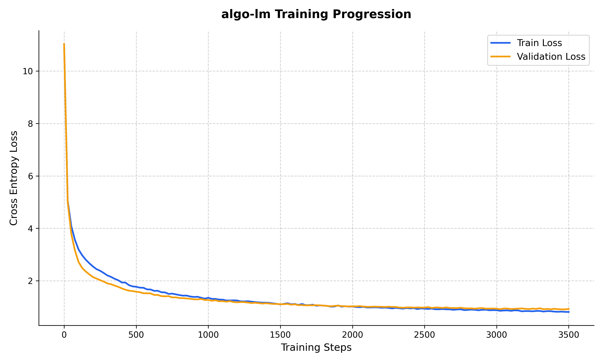

# algo-lm

An educational, bottom-up implementation of a decoder-only Generative Pre-trained Transformer (GPT-2 architecture) built from scratch in PyTorch. 

`algo-lm` is designed to demonstrate the foundational lifecycle of a causal language model—from raw tokenization and low-level attention mechanics to custom pre-training and convergence analysis on domain-specific C++ competitive programming corpora.

---

## Highlights

- **From-Scratch Architecture:** Manual implementation of causal multi-head self-attention, learned positional embeddings, layer normalization (pre-norm configuration), and residual feed-forward networks without relying on high-level transformer abstractions (`torch.nn.Transformer`).
- **Hardware Agnostic:** Optimized for mixed environments, featuring MPS support for Apple Silicon debugging and native CUDA execution with pinned memory for GPU-accelerated training.
- **Efficient Streaming:** Memory-mapped binary dataset streaming (`np.memmap`) for zero-overhead token ingestion across large pre-training corpora.
- **Empirical Telemetry:** Full checkpoint resumption and granular loss monitoring tracking convergence down to an authentic validation plateau.

---

## Model Architecture Specifications

| Parameter | Specification | Notes |
| :--- | :--- | :--- |
| **Model Size** | ~49.4M Parameters | Total non-embedding & embedding weights |
| **Layers (`n_layers`)** | 6 | Identical Transformer decoder blocks |
| **Attention Heads (`n_head`)** | 6 | 64-dimensional projections per head |
| **Embedding Dim (`n_embd`)** | 384 | Hidden dimension across all blocks |
| **Context Length (`block_size`)** | 256 | Maximum causal context window |
| **Vocabulary Size (`vocab_size`)** | 50,257 | GPT-2 Byte-Pair Encoding (`tiktoken`) |
| **Dropout** | 0.2 | Applied to attention projections and FFN blocks |

---

## Pre-Training & Metrics

The model was pre-trained on a custom corpus of algorithmic C++ source code processed into contiguous 16-bit token arrays.

### Hyperparameters
- **Hardware:** NVIDIA Tesla T4 GPU (16 GB VRAM)
- **Optimizer:** AdamW ($\beta_1 = 0.9$, $\beta_2 = 0.999$, $\epsilon = 10^{-8}$)
- **Learning Rate:** $3 \times 10^{-4}$ (Constant schedule)
- **Batch Size:** 16 sequences ($4,096$ tokens per step)
- **Total Steps:** 5,000 iterations (~20.48M tokens exposed during training)
- **Evaluation Cadence:** Every 25 steps across 200 validation batches

### Convergence Telemetry

| Checkpoint | Step | Train Cross-Entropy | Validation Cross-Entropy | Perplexity (Val) |
| :--- | :--- | :--- | :--- | :--- |
| **Initial Initialization** | 0 | 11.0168 | 11.0281 | ~61,580 |
| **Syntax Acquisition** | 500 | 1.7704 | 1.5822 | ~4.87 |
| **Structural Alignment** | 2,500 | 0.9366 | 0.9765 | ~2.65 |
| **Optimal Generalization** | **4,500** | **0.7451** | **0.8851** | **~2.42** |
| **Final Checkpoint** | 5,000 | 0.7132 | 0.8984 | ~2.46 |



> **Empirical Takeaway:** The model demonstrates robust convergence, breaking past the $1.0$ loss barrier by step $2,000$. The validation curve reaches its global minimum at step **4,500** ($0.8851$), after which a subtle upward divergence marks the onset of memorization, establishing the 4,500-step checkpoint as the optimal pre-trained base model.

---

## Qualitative Capabilities (Base Pre-Trained)

At a validation cross-entropy loss of $\sim 0.88$, `algo-lm` exhibits strong structural awareness of C++ competitive programming conventions:
- Accurately constructs `#include <bits/stdc++.h>` headers and macro definitions (`boost`, fast I/O idioms).
- Employs valid function prototypes (`void solve()`, `int main()`).
- Replicates common variable naming schemes and problem idioms (`cin >> n`, dynamic programming arrays, standard loop bounds).

---

## Quick Start

```bash
git clone [https://github.com/VaiBrahma/algo-lm.git](https://github.com/VaiBrahma/algo-lm.git)
cd algo-lm
pip install torch numpy tiktoken